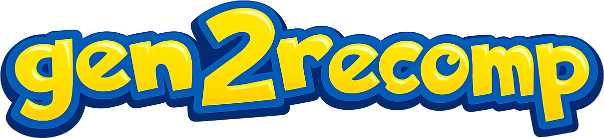

# gen2recomp

<p align="center"></p>

<p align="center"></p>
<a href="https://discord.gg/gb8TuPKJv">Gen2Recomp Discord!</a>  
<p align="center"><b>by UNDERdecodedHD</b><br>
a fork of <a href="https://github.com/bryanthaboi/gen1recomp">Gen1Recomp</a> by
<a href="https://github.com/bryanthaboi">bryanthaboi</a> and
<a href="https://boisclub.games">BOIS CLUB GAMES</a></p>

A native LÖVE2D recreation of Poke Gold, Silver and Crystal, built on Gen1Recomp's
Red/Blue/Yellow engine. The engine, script VM, and map behavior are
hand-written Lua; game data and graphics are decoded from a ROM supplied by the
player.

gen2recomp keeps everything the upstream project does for Generation I and adds
the Generation II half: the Gen2 script VM and its command table, the Johto and
Kanto world, day/night, breeding and the Day-Care, the Pokegear, shinies, held
items, and the Gold/Silver title sequence.

It has since grown well past Generation II. The same launcher now imports and
runs **FireRed** and **Emerald** (Gen 3), **Platinum**, **HeartGold** and
**SoulSilver** (Gen 4), and **Black** and **White** (Gen 5), plus the
**Polished Crystal** and **Prism** romhacks — all side by side, all from your
own cartridge dumps. Around the games sit the **Monster Walker** (a
next-gen Pokéwalker with minigames and a Watt Shop), a **Map Editor**, a
**Save Editor**, machine **translation** into 25 languages, **cloud saves**,
dual-screen support for the DS games, and touch controls. See
[What's New](#whats-new) for the tour.

> [!CAUTION]
> **Neither this project nor Gen1Recomp is affiliated with the website
> `gen1recomp[.]com`.** That site is not run by either project and was not
> authorized by anyone involved. Do not download anything from it, and treat
> anything it hosts or claims as untrustworthy. Even if it links back to a real
> repository, the people behind it can change its content at any time. This
> GitHub repository is the only official source for gen2recomp.

This project does not include a ROM, emulate the Game Boy, GBA or DS,
transpile assembly, or download a disassembly. A canonical cartridge dump of
one of the [supported games](#supported-games) is the only game content input.

The ROM is verified, used during import, and then released from memory. It is
not copied into the cache. Later launches load the private generated cache and
do not ask for the ROM again. Every version can be imported and played side by
side.

## Quick Start

Open the desktop app. On first boot, choose your legally obtained `.gb` /
`.gbc` / `.gba` / `.nds` file or drop it onto the window. Import takes a few
seconds for Gen 1, a couple of minutes for Gen 2, and longer for the GBA and DS
games, then the game starts automatically. Have a whole folder of dumps?
**Tools → Import ROMs** takes several files at once and imports every one it
recognises.

On a console or handheld there is no file picker to open: you copy the dump
into a folder the launcher scans instead. See
[Downloads](#downloads--which-file-do-i-want) for the exact path per device.

### Supported games

Only specific canonical dumps are accepted. The importer verifies SHA-1 before
creating any game data; a dump it does not accept is named (game, region,
revision) so you know why — see [docs/rom-revisions.md](docs/rom-revisions.md).

| Game | System | Stage | SHA-1 |
| --- | --- | --- | --- |
| Red | GB | Stable | `ea9bcae617fdf159b045185467ae58b2e4a48b9a` |
| Blue | GB | Stable | `d7037c83e1ae5b39bde3c30787637ba1d4c48ce2` |
| Yellow | GB | Stable | `cc7d03262ebfaf2f06772c1a480c7d9d5f4a38e1` |
| Gold | GBC | Stable | `d8b8a3600a465308c9953dfa04f0081c05bdcb94` |
| Silver | GBC | Stable | `49b163f7e57702bc939d642a18f591de55d92dae` |
| Crystal (Rev 1) | GBC | Stable | `f2f52230b536214ef7c9924f483392993e226cfb` |
| Crystal (Rev 0) | GBC | Stable | `f4cd194bdee0d04ca4eac29e09b8e4e9d818c133` |
| Polished Crystal 3.2.3 | GBC | Beta | `6930b48af5844d373e3c9130f26d6dd1084cf4ed` |
| Prism | GBC | Experimental | `752076692ae3387cf426ce5f51a98c6b60e8df6a` |
| FireRed (Rev 0) | GBA | Alpha | `41cb23d8dccc8ebd7c649cd8fbb58eeace6e2fdc` |
| Emerald | GBA | Alpha | `f3ae088181bf583e55daf962a92bb46f4f1d07b7` |
| Platinum (Rev 1) | DS | Pre-alpha | `0862ec35b24de5c7e2dcb88c9eea0873110d755c` |
| Platinum (Rev 0) | DS | Pre-alpha | `ce81046eda7d232513069519cb2085349896dec7` |
| HeartGold (USA) | DS | Pre-alpha | `4fcded0e2713dc03929845de631d0932ea2b5a37` |
| SoulSilver (USA) | DS | Pre-alpha | `f8dc38ea20c17541a43b58c5e6d18c1732c7e582` |
| Black (USA/EU) | DS | Pre-alpha | `26ad0b9967aa279c4a266ee69f52b9b2332399a5` |
| White (USA/EU) | DS | Pre-alpha | `bc696a0dfb448c7b3a8a206f0f8214411a039208` |

HeartGold, SoulSilver, Black and White dumps that have had their trailing `FF`
padding trimmed are also accepted, as long as every game byte is intact — see
[docs/hgss-bw-import.md](docs/hgss-bw-import.md). The launcher shows each
game's stage on its card; Alpha and Pre-alpha games are playable but expect
gaps and bugs.

The packaged app contains neither a ROM nor pre-extracted game data. Music,
sound effects, and cries are synthesized while the game runs from compact
audio channel programs copied out of the verified ROM.

### A note on Windows Defender warnings

Windows Defender sometimes flags LÖVE builds with a generic machine-learning
detection such as `Trojan:Win32/Wacatac!ml`. This is a known false positive:
the exe is the official LÖVE runtime with the game archive appended (the
standard way LÖVE games ship), and Defender's heuristics distrust unsigned
executables with appended data. Releases publish SHA-256 checksums
(`sha256sums.txt`) so you can verify your download, and you can confirm a
flagged file yourself on [VirusTotal](https://www.virustotal.com), where these
builds come back clean on every engine except Defender's heuristic.

## What's New

Everything below arrived since this README was last updated.

### New games

- **FireRed and Emerald** run on a native Gen 3 engine: the Gen 3 bag, PC and
  Item PC, naming screen, Oak's intro, Town Map FLY, V.S. Seeker rematches,
  Teachy TV, the Battle Frontier groundwork, Berry Blender, and much more ROM
  parity work. Both are labelled **ALPHA**.
- **Platinum** brings Sinnoh in 3D from the cartridge's own terrain meshes and
  props, the Pokétch on the lower screen, bikes, double battles, the
  Underground menu, and wide-screen battles.
- **HeartGold, SoulSilver, Black and White** import and boot to the field —
  including Professor Juniper's intro in BW — as **PRE-ALPHA** builds.
- **Polished Crystal** (beta) and **Prism** (experimental) romhacks, with
  audio, overworld rendering and feature-parity fixes.
- **Mass ROM import**: pick a folder's worth of dumps at once.

### Monster Walker

A full-screen app in the launcher sidebar, a next-gen take on the HGSS
Pokéwalker that works with **every** imported game:

- Take a Pokémon out of any game's PC, walk it with your phone's step counter
  (Android), and send it home levelled up with whatever it found.
- All 27 original courses, Poké Radar battles, Dowsing, friendship and the
  7-day step history, faithful to the original rules.
- **Minigames**: Catch Timing, Jump Runner, Memory Match, Rhythm Tap and
  Treasure Hunt, each with its own leaderboard.
- **Watt Shop**: spend watts on items for each generation, a daily Pokémon
  stock, weekly Mystery Gifts, cosmetics, and the real per-game **event
  distributions** (event Pokémon and key items), delivered straight into your
  save.
- Passive watts while the app is open, a daily login streak, and 26
  achievements.

Every save the Walker touches is backed up first. Details in
[docs/pokewalker.md](docs/pokewalker.md).

### Map Editor

**Tools → Map Editor** opens any imported game's maps — Gen 1 through Gen 4 —
in a 2D view or the 3D voxel world. Paint tiles, place NPCs and trainers, edit
their text, events and flags, shape voxel height, then export your work as a
content mod. Nothing is written to the ROM. The full manual (also in the editor
under **?**) is [docs/MAP_EDITOR.md](docs/MAP_EDITOR.md); per-generation
differences are in [docs/map-editor-gen34.md](docs/map-editor-gen34.md).
Classic Tiled round-tripping is still available
([docs/tiled-map-editing.md](docs/tiled-map-editing.md)).

### Launcher

The launcher now has a sidebar — **News, Games, Monster Walker, Mods, Tools,
Settings** — with box art and descriptions you can scrape for each game, a
choice of layouts, custom backgrounds (including your own `.ogv` video) and
background music. **Tools** collects:

| Tool | What it does |
| --- | --- |
| Map Editor | Edit an imported game's maps |
| Save Editor | Open a save slot and edit it live — party, PC, items, badges, and creating Pokémon |
| Translate a Game | Machine-translate a game's text |
| Import a Save | Bring in a `.sav` / `.dsv` from an emulator or cartridge (Gen 1–5) |
| Export a Save | Write the active slot out for an emulator |
| Import ROMs | Pick one or more ROM files to import |
| Touch Controls | Lay out the on-screen controls |
| Scrape Game Art | Fetch box art and a description for a game |
| Sync Saves | Sync every game's saves with the cloud |
| Restore a Save | Browse every backup of a slot and restore one |

### Languages and translation

The launcher and engine are localised (including Brazilian Portuguese), and
**Translate a Game** machine-translates a game's own text into 25 languages —
French, German, Spanish, Italian, both Portugueses, Dutch, Polish, Japanese,
Simplified Chinese, Russian and more — with official Pokémon names kept from a
glossary. Choose a language per game or for the whole launcher.

### Cloud saves

**Settings → Cloud Saves** syncs saves through a local sync folder (OneDrive,
Google Drive, Dropbox, iCloud), or signs straight into **Google Drive** or
**OneDrive** with a short device code. A save is never replaced on its first
sync, conflicting copies are both kept, and each side keeps backups. See
[docs/cloud-saves.md](docs/cloud-saves.md).

### Dual screens, touch and controllers

- **Dual-screen devices** (Android dual-screen handhelds and second displays)
  put the DS games' lower screen — the Pokétch, menus — on the second panel;
  on Gen 1–3 the second screen becomes a live **save companion** editor.
- Reworked **touch controls** with a layout editor and gesture fixes.
- DS **X / Y** buttons for Gen 4+ (see [Controls](#controls)).

### Safer saves and storage

- Every save is written atomically, verified, and snapshotted; a lost or
  corrupt save is recovered automatically from the best copy, and
  **Tools → Restore a Save** brings back older ones. See
  [docs/save-safety.md](docs/save-safety.md).
- **Settings → Game Data Folder** moves ROM caches, mods and imports to
  another drive or SD card ([docs/data-location.md](docs/data-location.md)).

### Mods and visuals

- `DRAMATIC_SHAPE` voxels extended to Gen 3 and HGSS/BW with big performance
  work, plus cave darkness and many building profiles.
- A streaming download API (`src/net/Fetch.lua`) lets mods such as the
  **HD sheets** installer pull large asset packs with progress.
- New mod hooks (party submenu options, and more), copy-on-import for mod
  files, and launcher/gamedata customisation from mods.

## Downloads — which file do I want?

Every release publishes one archive per platform, all built from the same
payload in the same run. Grab the row that matches your device.

| Device | File | Then |
| --- | --- | --- |
| Windows | `Gen2Recomped-<ver>-windows.zip` | Unzip, run the `.exe` |
| Windows (Store-style install) | `Gen2Recomped-<ver>-windows.msix` **+ the `.cer`** | See [MSIX](#windows-msix) below — the `.cer` is required |
| macOS | `Gen2Recomped-<ver>-macos.zip` | Unzip, drag to Applications |
| Linux (x86-64) | `Gen2Recomped-<ver>-linux.zip` | Unzip, run the AppImage inside |
| Linux (ARM64 / Raspberry Pi / SBC) | `Gen2Recomped-<ver>-linux-arm64.AppImage` | `chmod +x`, run it |
| Steam Deck | `Gen2Recomped-<ver>-linux.zip` | The x86-64 one — the Deck is x86 |
| Android | `Gen2Recomped-<ver>-android.apk` | Allow unknown sources, install |
| Nintendo Switch | `Gen2Recomped-<ver>-switch.zip` | See [Switch](#nintendo-switch) below |
| Xbox (Dev Mode) | `Gen2Recomped-<ver>-xbox-uwp.zip` | See [Xbox](#xbox-dev-mode) below |
| Anbernic RG34XXSP | `Gen2Recomped-<ver>-rg34xxsp-stockos64-mod.zip` | See [Handhelds](#handhelds) below |
| iOS | `Gen2Recomped-<ver>-ios.ipa` | Sideload — see [iOS](#ios) below |
| Already have LÖVE 11.5 | `Gen2Recomped-<ver>.love` | `love Gen2Recomped-<ver>.love` |

`sha256sums.txt` covers every asset in the release. The `.love` is also what
the in-app updater downloads, so it is the smallest file if you are updating
by hand.

**No download contains a ROM or any game data.** Every platform asks for your
own cartridge dump on first launch.

Some assets are missing from a release only when that platform's build job
failed; the release notes say so explicitly rather than silently omitting it.

### Windows (MSIX)

Download **both** the `.msix` and the `.cer`. Windows refuses to install a
package it cannot verify, and the certificate is what makes it verifiable.
Once per machine, in an **elevated** PowerShell:

```powershell
Import-Certificate -FilePath .\Gen2Recomped-<ver>-windows.cer `
  -CertStoreLocation Cert:\LocalMachine\TrustedPeople

Add-AppxPackage .\Gen2Recomped-<ver>-windows.msix
```

`LocalMachine`, not `CurrentUser` — App Installer only reads the machine
store, and a certificate in the user store produces error `0x800B010A`, which
looks exactly like having imported nothing. Later releases then install with
just `Add-AppxPackage`. Details and the signing setup are in
[docs/msix-signing.md](docs/msix-signing.md).

If you would rather not deal with certificates at all, take the plain
`-windows.zip` instead — it is the same game.

### Nintendo Switch

Needs a homebrew-capable console (Atmosphère + hbmenu). Extract
`Gen2Recomped-<ver>-switch.zip` at the **root** of your microSD, merging
folders when asked. You get:

```
switch/gen2recomp/gen2recomp.nro          the launcher
switch/gen2recomp/Gen2Recomp/imports/     put your cartridge dump here
switch/gen2recomp/Gen2Recomp/exports/     battery saves come back out here
```

Then:

1. Copy a legal `.gb` / `.gbc` into `switch/gen2recomp/Gen2Recomp/imports/`.
   Dumps are matched by SHA-1, so the filename does not matter.
2. Launch through hbmenu with a title override (hold **R** on HOME and open
   any installed game).
3. Press **Import** in the launcher — it scans that folder.

Launcher controls: left stick or D-pad moves the pointer, **A** clicks,
**L**/**R** change tabs, **+**/**−** play or import on the current tab.

Updating: re-extract the zip and keep the `Gen2Recomp/` folder — that is where
your saves, imported ROMs, mods and options live. The bundled OTA launcher can
also fetch new releases from the console itself.

### Xbox (Dev Mode)

Needs Developer Mode on the console — a retail Xbox cannot install this.
`Gen2Recomped-<ver>-xbox-uwp.zip` is a UWP app package; upload it through the
Xbox Device Portal in your browser, or `Add-AppxPackage` it from a paired PC.
Build notes are in [ports/uwp/BUILD.md](ports/uwp/BUILD.md).

### Handhelds

`Gen2Recomped-<ver>-rg34xxsp-stockos64-mod.zip` targets the **Anbernic
RG34XXSP** on Stock OS 64-bit MOD with PortMaster, and bundles its own LÖVE
runtime, so no separate runtime download is needed. Unzip into the card's
`roms/PORTS/` folder so `Gen2recomp.sh` and `gen2recomp/` sit side by side,
drop your dump into `gen2recomp/lovegame/`, then launch it from Ports. Install
steps, controls and troubleshooting are in
[docs/anbernic-rg34xxsp.md](docs/anbernic-rg34xxsp.md).

Other ARM64 handhelds and single-board computers can use the generic
`-linux-arm64.AppImage` instead.

### Android

Install the APK and pick your dump with the system file picker on first
launch. If your device has no document picker, copy the `.gb` / `.gbc` into
the app's own folder — the launcher shows the exact path. Build steps and the
packaging layout are in [mobile/ANDROID.md](mobile/ANDROID.md).

### iOS

There is no App Store build; sideload the `.ipa` with AltStore from Windows or
a Mac — see [docs/ios-sideload.md](docs/ios-sideload.md). To build and install
from source on a Mac, see [docs/ios-install.md](docs/ios-install.md).

### Updating

Desktop and mobile builds check GitHub Releases and can update themselves.
Console builds tell you a release exists but will not replace themselves — a
packaged console app cannot rewrite its own files — so update those the same
way you installed them. The Switch is the exception: its OTA launcher replaces
both NROs in place. See [docs/updater.md](docs/updater.md).

## Controls


| Action | Keyboard          | Controller         |
| ------ | ----------------- | ------------------ |
| Move   | Arrow keys / WASD | D-pad / left stick |
| A      | Z / Enter / Space | A                  |
| B      | X / Backspace     | B                  |
| Start  | Escape            | Start              |
| Select | Tab / Shift       | Back / Select      |
| X (Gen 4+) | `/`           | North face button (Xbox Y / PS Triangle / Nintendo X) |
| Y (Gen 4+) | `'`           | West face button (Xbox X / PS Square / Nintendo Y) |


Rebind any of these in-game under **OPTIONS → CONTROLS**. Controllers are
supported out of the box, and touch devices get on-screen controls you can
lay out from **Tools → Touch Controls**. X opens the field menu on DS games;
Y uses the registered item.

### Hotkeys


| Key       | What it does                                         |
| --------- | ---------------------------------------------------- |
| `-` / `=` | Zoom out / in (overworld; also mouse wheel)          |
| `2`       | Cycle COLORS                                         |
| `3`       | Cycle TILT (free-roam overworld)                     |
| `4`       | Cycle ZOOM through every level (free-roam overworld) |
| `5`       | Cycle GBC FX                                         |
| `F1`      | Save                                                 |
| `F2`      | Load                                                 |
| `F10`     | Open / close the mod manager                         |


COLORS, TILT, ZOOM, GBC FX, and VOID FILL are also in the Options menu
and persist in `options.lua`.

### Low-end devices

**OPTIONS → PERFORMANCE** scales the port's optional extras for weaker
hardware: **HIGH** (everything on), **BALANCED** (no 3D tilt or GBC FX),
**LOW** (also no survey zoom, FPS capped), or **AUTO** — the default, which
picks a tier from your device (ARM handhelds → LOW, phones → BALANCED,
normal desktops → HIGH, unchanged). It only scales presentation; the
fixed-step game logic is identical on every tier, and a lower tier hides
your tilt/zoom/GBC-FX preferences without forgetting them. Details in
[docs/new-features.md](docs/new-features.md#performance-tier-low-end-devices).

### Rulesets

**OPTIONS → RULESET** picks which set of Generation I battle behaviors to run.
Both rulesets share the same damage formulas; they differ only in whether
the original's quirks are kept. The setting persists in `options.lua`, and
mods can register their own. Gold and Silver always run their own Gen 2 rules.

`gen1_faithful` is the default and reproduces the original cartridge,
famous bugs included:

| Rule                        | Behavior                                              |
| --------------------------- | ----------------------------------------------------- |
| `oneIn256Miss`              | A 100%-accurate move still misses on a roll of 255     |
| `critUsesBaseSpeed`         | Crit rate reads base speed, not the current stat       |
| `critIgnoresStages`         | Crit rate ignores stat stages                          |
| `focusEnergyBug`            | FOCUS ENERGY quarters the crit rate instead of x4      |
| `enemyUnlimitedPP`          | Enemies never spend PP, so they never Struggle         |
| `hyperBeamSkipRechargeOnKO` | HYPER BEAM skips its recharge when the target faints   |
| `randMin` / `randMax`       | Damage random factor 217-255                           |

`modern_clean` keeps the formulas but removes the notorious quirks:

| Rule                        | Behavior                                              |
| --------------------------- | ----------------------------------------------------- |
| `oneIn256Miss`              | Off: a 100%-accurate move always hits                  |
| `critUsesBaseSpeed`         | Unchanged: crit rate still reads base speed            |
| `critIgnoresStages`         | Off: stat stages count toward the crit rate            |
| `focusEnergyBug`            | Off: FOCUS ENERGY raises the crit rate as intended     |
| `enemyUnlimitedPP`          | Off: enemies deplete PP and Struggle when empty        |
| `hyperBeamSkipRechargeOnKO` | Off: HYPER BEAM always recharges, like Gen 2+          |
| `randMin` / `randMax`       | Damage random factor 217-255, same as faithful         |

## Running From Source

Requires LÖVE 11.x. Place a Gold or Silver ROM in the project folder and
double-click `Play-Mac.command` or `Play-Windows.bat`, or run:

```sh
scripts/setup.sh --rom "/path/to/Poke Gold.gbc"   # or Silver.gbc / Red.gb / ...
scripts/run.sh
```

On Windows, `scripts\setup.ps1` and `scripts\run.ps1` do the same thing — see
below. After the first import, `love .` is enough.

### Windows

The easiest path is to double-click **`Play-Windows.bat`**. It runs
`scripts\bootstrap.ps1`, which checks for the two things the port needs,
offers to install whichever is missing through `winget`, imports your ROM, and
starts the game. Later runs skip straight to launching.

To install the prerequisites yourself:

```powershell
winget install --exact --id Python.Python.3.12
winget install --exact --id Love2d.Love2d
```

LÖVE can equally come from [love2d.org](https://love2d.org) — the scripts look
for it on `PATH` and in the usual `Program Files\LOVE` locations. Python 3 must
be on `PATH`; the setup script builds its own `.venv` for the importer's
dependencies, so nothing is installed system-wide.

Then, from the project folder:

```powershell
powershell -ExecutionPolicy Bypass -File scripts\setup.ps1 -Rom C:\path\to\Gold.gbc
powershell -ExecutionPolicy Bypass -File scripts\run.ps1
```

`scripts\play.ps1` does both steps in one go. Drop the `-Rom` argument and
setup picks up the first `.gb` / `.gbc` in the project folder. After the first
import, `love .` is enough.

`-ExecutionPolicy Bypass` is what keeps PowerShell from refusing to run the
scripts under its default policy; it applies only to that one invocation and
changes nothing system-wide. `run.ps1` prefers `lovec.exe` over `love.exe`
when it can find it, because `love.exe` is a GUI-subsystem binary that
swallows `print` output — worth knowing if you are debugging.

Saves, options, and the generated data cache live in
`%APPDATA%\LOVE\pokemon-love2d\` (Gold and Silver keep theirs in the `gold\`
and `silver\` subfolders) unless you enable [Portable Mode](#portable-mode).
Controllers work through SDL2 and need no driver setup. If Defender objects to
a packaged build, see [the note above](#a-note-on-windows-defender-warnings).

### Linux

`scripts/setup.sh` and `scripts/run.sh` are the Linux path too. They need
LÖVE 11.x and Python 3 (with `venv`) on `PATH`; the setup script only
auto-installs LÖVE on macOS, so install it first with your package manager:

```sh
# Debian / Ubuntu
sudo apt install love python3 python3-venv

# Fedora
sudo dnf install love python3

# Arch
sudo pacman -S love python

# Any distro (Flatpak)
flatpak install flathub org.love2d.love2d
```

Then, from the project folder:

```sh
chmod +x scripts/*.sh                              # first time only
scripts/setup.sh --rom "/path/to/Poke Gold.gbc"
scripts/run.sh
```

`scripts/play.sh` does both steps in one go. After the first import, `love .`
is enough — or `flatpak run org.love2d.love2d .` if you installed the Flatpak.
If you use the official AppImage from [love2d.org](https://love2d.org), make it
executable (`chmod +x love-11.5-x86_64.AppImage`) and either put it on `PATH`
as `love` or run `./love-11.5-x86_64.AppImage .` directly.

Saves, options, and the generated data cache live in
`~/.local/share/love/pokemon-love2d/` (Gold and Silver keep theirs in the
`gold/` and `silver/` subfolders) unless you enable
[Portable Mode](#portable-mode). Controllers work through SDL2; if yours is not
detected, check that your user is in the `input` group or that `udev` rules for
the pad are installed. On Wayland with older LÖVE builds, launching with
`SDL_VIDEODRIVER=x11` through XWayland avoids most window and input quirks.

The Gen 2 importer reads the symbol files under `tools/vendor/symbols/`
(`pokegold.sym` / `pokesilver.sym`); `scripts/setup_gen2_symbols.ps1` fetches
them. The regression suite lives in `tests/drivers/`; each driver runs with
`POKEPORT_VERSION=gold POKEPORT_DRIVER=tests/drivers/<name>.lua love .`.

## Portable Mode

By default the game keeps your save, options, and the private ROM-derived
data cache in your OS's normal per-user app data folder. To keep everything
next to the game instead (handy for a USB stick or portable drive you carry
between computers), drop an empty file named `portable.txt` next to the app
(next to the `.app`/`.exe`, or next to `main.lua`/`conf.lua` when
running from source), then launch the game. Portable mode is desktop-only
(Windows, Linux, macOS); it has no effect on Android or iOS, where the app
runs from a read-only package.

With `portable.txt` present:

- `save.lua`, `save.lua.bak`, and `options.lua` are read from and written to
that same folder instead of the OS save directory.
- A ROM import writes the generated `data/generated` and `assets/generated`
cache straight into that folder too (nothing is left in the OS save
directory), so a later launch reuses it without asking for the ROM again
even on a different computer, as long as the same folder comes along.
- Deleting `portable.txt` switches back to the normal OS save directory; nothing
already written to either location is touched automatically, so copy files
over yourself if you want to carry existing progress across the switch.

## Modding

The game ships a native mod platform: content registries, events and hooks,
per-mod saves and options, and an in-game manager. Start with
[docs/modding.md](docs/modding.md) and
[CONTRIBUTING-mods.md](CONTRIBUTING-mods.md).

Shipped example mods, one per kind of author, live in [mods/](mods/) —
including `DRAMATIC_SHAPE`, the voxel renderer, extended by UNDERdecodedHD for
Generation II support.

Maps can be edited in the built-in [Map Editor](#map-editor) or in
[Tiled](https://www.mapeditor.org), and exported back out as a mod; see
[docs/MAP_EDITOR.md](docs/MAP_EDITOR.md) and
[docs/tiled-map-editing.md](docs/tiled-map-editing.md).

## Bugs and Ideas

Found a bug? A warp dropping you somewhere it shouldn't, a battle doing math
that looks wrong, text in the wrong box, anything that does not match the
original game — open an issue and attach a screenshot if you can. It saves a
lot of back and forth, and if you can't get one, describe what you saw instead.

Same for features: say what you want, why it is worth doing, and how you
picture it working. A request with real detail is one that can actually get
built.

## Docs

- [docs/architecture.md](docs/architecture.md) — runtime details
- [docs/gen2-migration-roadmap.md](docs/gen2-migration-roadmap.md) — what is
done and what is left in the Gen 2 port
- [docs/gen2-script-engine.md](docs/gen2-script-engine.md) — the Gen 2 script VM
- [docs/behavior-porting-notes.md](docs/behavior-porting-notes.md) — formula
provenance
- [docs/known-differences.md](docs/known-differences.md) — where the port still
diverges from the cartridge
- [docs/rom-revisions.md](docs/rom-revisions.md) — which dumps each game
accepts, and why others are refused
- [docs/hgss-bw-import.md](docs/hgss-bw-import.md) — HeartGold, SoulSilver,
Black and White import status
- [docs/gen4-platinum.md](docs/gen4-platinum.md) and
[docs/platinum-parity-progress.md](docs/platinum-parity-progress.md) — the
Platinum port
- [docs/firered-port-handoff.md](docs/firered-port-handoff.md) — the FireRed port
- [docs/pokewalker.md](docs/pokewalker.md) — the Monster Walker
- [docs/MAP_EDITOR.md](docs/MAP_EDITOR.md) — the map editor manual
- [docs/launcher.md](docs/launcher.md) — the launcher
- [docs/cloud-saves.md](docs/cloud-saves.md) — cloud saves
- [docs/save-safety.md](docs/save-safety.md) — how saves are kept and restored
- [docs/data-location.md](docs/data-location.md) — the game data folder
- START > LINK connects two copies directly over UDP.

## Credits

gen2recomp is by **UNDERdecodedHD**, forked from **Gen1Recomp** by
**bryanthaboi** and **BOIS CLUB GAMES, LLC**. The Generation I engine, mod
platform, renderer, and tooling are theirs; the Generation II import, script
VM, world, and battle work are this fork's. See [LICENSE.MD](LICENSE.MD) for
the full copyright split.

Contributions by **Roxas2712** — <https://github.com/Roxas2712>. Original native
asset-producer additions are covered by [the contribution terms](LICENSE-ROXAS2712.md),
including the specific integration permission for Cedric / UNDERdecoded. Earlier
grants and other contributors' rights remain effective.

## Licence in one paragraph

Two parts. **Everything inherited from Gen1Recomp, and every shared engine
file since, stays MIT** under its original authors' copyright — that is the
default, and it is most of the repository. **The Generation II components
written for this fork are source-available rather than open source**
(© 2026 UNDERdecodedHD): read them, run them, change your own copy, and write
and even sell mods against them — but don't redistribute or fork them. A file
is only in that second group if it is named in the list in
[LICENSE](LICENSE); everything else is MIT.

## Special Thanks

This project would not be possible without [pret](https://github.com/pret) —
the pret band of decompiling maniacs — and their
[pokered](https://github.com/pret/pokered),
[pokegold](https://github.com/pret/pokegold),
[pokeyellow](https://github.com/pret/pokeyellow),
[pokecrystal](https://github.com/pret/pokecrystal),
[pokefirered](https://github.com/pret/pokefirered),
[pokeemerald](https://github.com/pret/pokeemerald),
[pokeplatinum](https://github.com/pret/pokeplatinum), and
[pokeheartgold](https://github.com/pret/pokeheartgold) disassemblies and
decompilations.

The ADVANCED / "RED++" colour mode uses the SuperPalettes, per-species
palette map, and true overworld GBC colouring from
[pokered-gbc](https://github.com/Stewmath/pokered-gbc) by **FroggestSpirit**,
**Drenn**, and **Danny-E**, baked into
[data/palettes_gbc.lua](data/palettes_gbc.lua). Neither pokered-gbc nor the
pret disassemblies ship a licence file, so the palette tables in
[data/](data) are reproduced with attribution rather than under this
project's MIT grant, and will be removed on request from their authors.

