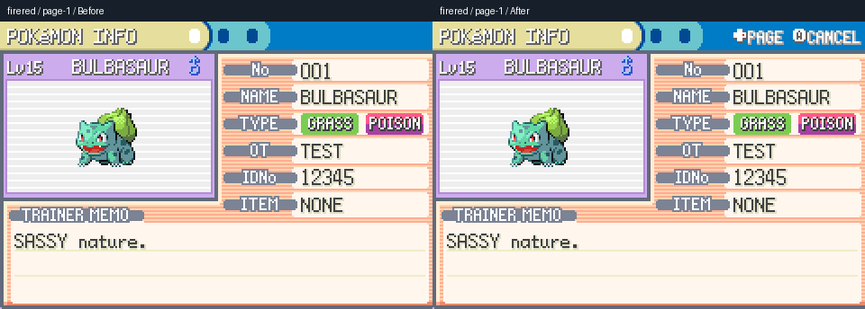
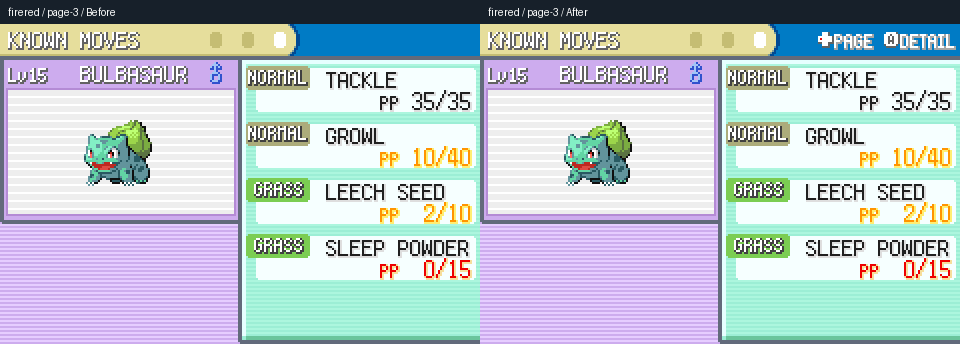
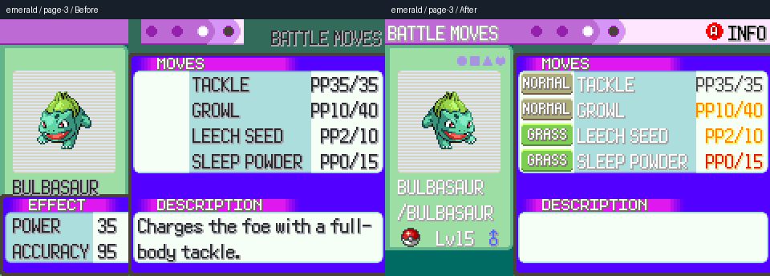
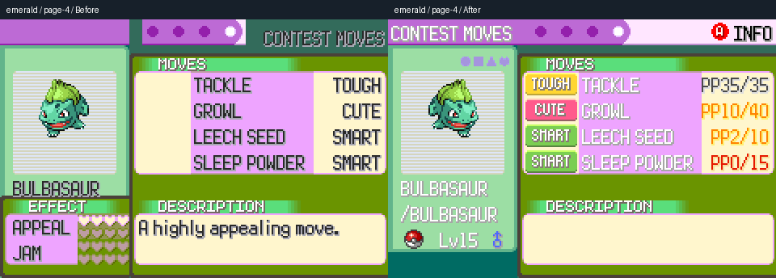
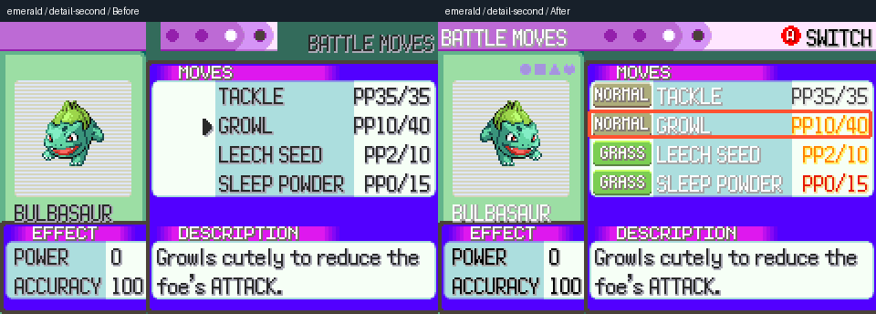

# FireRed and Emerald summary display corrections

Opening Emerald's battle or contest moves page currently omits the move-row
sprites and displays an effect panel before a move is selected. Its header,
left panel and PP colours also differ from the imported source. FireRed's
summary header omits the page/detail/cancel controls entirely.

This change reads the missing sprites, palettes and short control labels during
ROM import and supplies the presentation through `Gen3SummaryLayout`. Navigation,
move swapping, slot identities, PP, learning callbacks and save data remain owned
by the existing `Gen3SummaryMenu` controller. Old caches without the additional
metadata and unsupported source revisions retain the existing renderer. Only the
two affected games receive a cache revision and new required files.

The importer recognizes BPEE revision 0 and BPRE revision 0 by their GBA headers.
A separately verified manifest can provide `summaryPresentation` offsets and words
for another source. Compressed palette sizes, selection sprites, badge count and
palette banks are checked before cache metadata is published. No ROM, save,
extracted font, sprite atlas or language dictionary is included in this PR.

## Before and after

Left is the unmodified base `13af468b97dc37015d14ad5c71d7f067c3ee810d`;
right is this candidate. Both run in Gen2Recomped, without mods, using English
imports, the same prepared party, move slots, PP, trainer ID and native input.
The comparison script takes each complete 2048×1536 renderer frame, selects its
240×160 GBA viewport `(64,128,1920,1280)` at integer scale 8, then enlarges the
comparison by 2 with nearest-neighbour sampling. Colours and proportions are
unchanged. Original-frame hashes and crop coordinates are in
[the evidence manifest](images/gen3-summary/evidence.json).

### FireRed controls





### Emerald move rows and overview/detail separation







Additional pairs: [FireRed skills](images/gen3-summary/firered-page-2.png),
[FireRed selected move](images/gen3-summary/firered-detail-second.png),
[FireRed offered fifth move](images/gen3-summary/firered-learn-fifth.png),
[Emerald information](images/gen3-summary/emerald-page-1.png),
[Emerald skills](images/gen3-summary/emerald-page-2.png),
[Emerald offered fifth move](images/gen3-summary/emerald-learn-fifth.png).

These comparisons cover the specific summary changes. They do not certify every
screen, every palette, or unavailable language ROMs. The screenshots use actual
English imports. ROM-free tests also exercise six PP label configurations, long
labels and a custom nickname; this checks the shared display contract rather
than certifying complete translated games.

## Validation

`tests/gen3_summary_test.lua` exercises the actual native controller: A/B details,
row navigation, swaps preserving slot identity and PP, fifth-move selection and
cancellation, a short learning list, battle/contest IDs, PP thresholds, regional
and national dex lookup, duplicate species types, source controls, fallback
rendering and graphics/font cleanup after draw errors.

`tests/gen3_summary_parts_test.lua` uses synthetic input, with no ROM requirement:
compressed palettes, source sprite geometry/alpha, all 23 type/category frames,
missing contest-frame rejection, keypad/extra-symbol controls, unknown source and
wrong-game guards, and successful cache publication.

Both are part of `scripts/test.sh`. On the pinned base and candidate the existing
T1/T2 tier reports the same **27 `FAIL` lines**, including its summary lines.
The candidate adds no failure lines. The new two tiers, mod-SDK and Dramatic Shape
B30 tiers pass. This is not a claim that the repository's entire CI suite is green.

Both games were freshly imported with the candidate's normal importer in
isolated profiles. The opt-in real renderer test captures all normal pages,
second-move details and fifth-move cancellation: **11 views per revision**.
Every synchronous capture checks draw-time save immutability. Actual A/B input
checks callback count, return stack, move-table identity and unchanged PP.
The comparison tool passes **17 pixel checks**: eight source badge rows, six
source panel/header colours and three visible FireRed hint regions.

The current universal-language mod was also tested with actual German imports
in both games in isolated candidate profiles; its detail/fifth-row input and
draw-immutability checks pass. These mod-enabled checks are separate from the
native English screenshots above. The mod payload was left unchanged.

Code fingerprints and the bounded validation results are recorded in
[validation.json](images/gen3-summary/validation.json).

## Reproduce

From the repository root with LuaJIT:

```sh
luajit tests/gen3_summary_parts_test.lua
luajit tests/gen3_summary_test.lua .
LUA=luajit bash scripts/test.sh
```

With your own imported ROM and a new disposable profile, set `POKEPORT_VERSION`
to `firered` or `emerald`, `POKEPORT_DRIVER=tests/gen3_summary_capture.lua` and
`QA_SUMMARY_OUT` to an existing output directory. Set `QA_EXPECT_SUMMARY=1` for
the candidate; omit it on the base. Disable mods in both profiles. Import the
candidate normally so its new resource stage and cache revision run.

The capture driver can be used unmodified on the base via an absolute
`POKEPORT_DRIVER` path. Keep all original frames and the Emerald candidate log.
With Python and Pillow installed:

```sh
python3 tools/compare_gen3_summary.py before-dir after-dir \
  --out comparison-dir \
  --badge-sheet /path/to/private/emerald/assets/generated/ui/summary_types.png \
  --capture-log candidate-emerald-capture.log \
  --base-revision 13af468b97dc37015d14ad5c71d7f067c3ee810d
```

The source badge sheet is consumed locally for pixel verification and is not
copied into the output directory.
